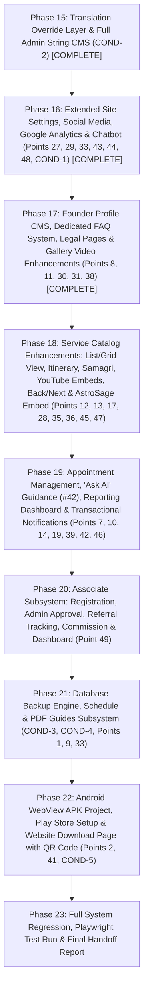

# Maharshi Kanad Jyotish Kendra (महर्षि कणाद ज्योतिष केंद्र)
# Comprehensive Gap Matrix: 49 Requirements & SRS Audit (Reconciled)

> **Audit Date**: 2026-10-25  
> **Production Target**: [https://kanadjyotishkendra.vercel.app/](https://kanadjyotishkendra.vercel.app/)  
> **Baseline Status**: Phases 1–14 Implemented (97/97 Tests Passing)  
> **Objective**: Exhaustive audit of all 48 requirements from the Client Requirement Document, the SRS Specification, the 49th Requirement ("Associate Panel"), and the mandatory Client Conditions.

---

## Executive Summary (Reconciled)

| Category | Total Items | Implemented | Partial | Missing | Implementation Readiness |
| :--- | :---: | :---: | :---: | :---: | :--- |
| **Client Requirement Points (1–48)** | 48 | 27 | 18 | 3 | Target: Phases 18, 19, 21, 22 |
| **New 49th Requirement (Associate Panel)** | 1 | 0 | 0 | 1 | Target: Phase 20 |
| **Mandatory Client Conditions (COND 1–5)** | 5 | 2 | 0 | 3 | COND 1 & 2 complete; COND 3–5 in Phases 21 & 22 |
| **Total Tracked Deliverables** | **54** | **29** | **18** | **7** | **53.7% Implemented, 33.3% Partial, 13.0% Missing** |

---

## Part 1: Comprehensive 49-Point Gap Matrix

### Legend
- 🟢 **IMPLEMENTED**: Fully functional in codebase, verified with automated unit/integration tests.
- 🟡 **PARTIAL**: Basic scaffold or partial logic exists; requires expansion, database fields, or admin control.
- 🔴 **MISSING**: Not yet implemented in the codebase; targeted for implementation in subsequent phases.

---

| # | Requirement As Given | Current Status | Codebase Evidence (File Paths) | Identified Gap & Scope to Implement |
| :-: | :--- | :---: | :--- | :--- |
| **1** | **Dynamic, Custom, CMS A to Z Admin Management control Website** | 🟡 **PARTIAL** | [src/app/[locale]/admin/layout.tsx](file:///C:/Users/anshu/Desktop/ClientWork/src/app/[locale]/admin/layout.tsx) [src/features/admin/](file:///C:/Users/anshu/Desktop/ClientWork/src/features/admin/) | Admin CMS exists for services, plans, offers, banners, marquee, blogs, testimonials, static pages, and vault. **Gap**: Needs admin translation/string override manager (Condition B), associate panel management, backup controls, and guide managers. |
| **2** | **100% Mobile Responsive, applicable for Professional Android App** | 🟡 **PARTIAL** | [src/app/globals.css](file:///C:/Users/anshu/Desktop/ClientWork/src/app/globals.css) [src/components/layout/Header.tsx](file:///C:/Users/anshu/Desktop/ClientWork/src/components/layout/Header.tsx) | Responsive broadsheet layout with 44px min touch targets and `overflow-x: clip`. **Gap**: Professional Android WebView Gradle wrapper APK project and website download page with admin QR code. |
| **3** | **Language – Hindi & English** | 🟡 **PARTIAL** | [src/i18n/request.ts](file:///C:/Users/anshu/Desktop/ClientWork/src/i18n/request.ts) [messages/hi.json](file:///C:/Users/anshu/Desktop/ClientWork/messages/hi.json) [messages/en.json](file:///C:/Users/anshu/Desktop/ClientWork/messages/en.json) | Bilingual `next-intl` dual routing in place. **Gap**: Client condition requires database string override layer so ALL UI labels, buttons, headers, and footer strings can be edited from admin without code changes. |
| **4** | **Website Theme, Saffron, Yellow, Maroon, High contrast** | 🟢 **IMPLEMENTED** | [tailwind.config.ts](file:///C:/Users/anshu/Desktop/ClientWork/tailwind.config.ts) [src/app/globals.css](file:///C:/Users/anshu/Desktop/ClientWork/src/app/globals.css) | Complete theme tokens configured (`saffron`, `maroon`, `earth`, `gold`), applied cleanly across components without raw hex values. |
| **5** | **Menu – About Us, Founder, Service, Plan, Gallery, Blog, Testimonial, Kundli, Kundli Matching, Prashna Kundli, Support, Registration, Login** | 🟢 **IMPLEMENTED** | [src/components/layout/Header.tsx](file:///C:/Users/anshu/Desktop/ClientWork/src/components/layout/Header.tsx) [src/components/layout/MobileNav.tsx](file:///C:/Users/anshu/Desktop/ClientWork/src/components/layout/MobileNav.tsx) | Header top utility bar and main nav bar with hover dropdown for About Us sub-links (Founder, Help, Gallery, Testimonials) and mobile drawer. |
| **6** | **User Panel, Registration with basic Details** | 🟢 **IMPLEMENTED** | [src/app/[locale]/account/page.tsx](file:///C:/Users/anshu/Desktop/ClientWork/src/app/[locale]/account/page.tsx) [src/app/[locale]/auth/register/page.tsx](file:///C:/Users/anshu/Desktop/ClientWork/src/app/[locale]/auth/register/page.tsx) | User registration with name, phone, email, password; account dashboard with profile details, booking history, and vault downloads. |
| **7** | **Login :- Different Login option as like Gmail, OTP, Google, Facebook & many option** | 🟡 **PARTIAL** | [src/lib/auth/authOptions.ts](file:///C:/Users/anshu/Desktop/ClientWork/src/lib/auth/authOptions.ts) [src/app/[locale]/auth/signin/page.tsx](file:///C:/Users/anshu/Desktop/ClientWork/src/app/[locale]/auth/signin/page.tsx) | Credentials (Email + Password), Mobile OTP (SMS), and Google OAuth implemented. **Gap**: Facebook OAuth provider was deferred; needs NextAuth Facebook provider setup with admin credentials configuration in Site Settings and `.env.example`. |
| **8** | **Founder Page, Upload Photo, with file & URL Links Designation, Role, Additional Link & Add New Page, footer note writing option** | 🟢 **IMPLEMENTED** | [src/app/[locale]/founder/page.tsx](file:///C:/Users/anshu/Desktop/ClientWork/src/app/[locale]/founder/page.tsx) [src/app/[locale]/admin/founder/page.tsx](file:///C:/Users/anshu/Desktop/ClientWork/src/app/[locale]/admin/founder/page.tsx) [src/app/api/admin/founder/route.ts](file:///C:/Users/anshu/Desktop/ClientWork/src/app/api/admin/founder/route.ts) | Fully dynamic Founder profile driven by `FounderProfile` model. Admin CMS allows uploading portrait or URL, editing designation, scholarly role, detailed bio, YouTube video discourse embed, additional external links, and ethical footer notes. Tested in [tests/phase17.test.ts](file:///C:/Users/anshu/Desktop/ClientWork/tests/phase17.test.ts) and [tests-e2e/phase17.spec.ts](file:///C:/Users/anshu/Desktop/ClientWork/tests-e2e/phase17.spec.ts). |
| **9** | **Admin Panel With A to Z CMS Control** | 🟡 **PARTIAL** | [src/app/[locale]/admin/layout.tsx](file:///C:/Users/anshu/Desktop/ClientWork/src/app/[locale]/admin/layout.tsx) | Admin console manages services, plans, offers, banners, marquee, blogs, testimonials, settings, and vault. **Gap**: Needs extension for Associates, App Download, Translations, Backups, and Guides. |
| **10** | **Dashboard with all Services reporting & Analyses** | 🟡 **PARTIAL** | [src/app/[locale]/admin/page.tsx](file:///C:/Users/anshu/Desktop/ClientWork/src/app/[locale]/admin/page.tsx) | Currently performs a basic redirect to `/admin/orders`. **Gap**: Missing comprehensive analytics dashboard with metrics for total revenue, active orders, appointment distribution, user registrations, and associate commission metrics. |
| **11** | **Gallery, Image & Video Upload option Through Link & Device saved file, Additional link & Youtube Link Add option** | 🟢 **IMPLEMENTED** | [src/app/[locale]/gallery/page.tsx](file:///C:/Users/anshu/Desktop/ClientWork/src/app/[locale]/gallery/page.tsx) [src/app/[locale]/admin/gallery/page.tsx](file:///C:/Users/anshu/Desktop/ClientWork/src/app/[locale]/admin/gallery/page.tsx) [src/app/api/admin/gallery/route.ts](file:///C:/Users/anshu/Desktop/ClientWork/src/app/api/admin/gallery/route.ts) | Media gallery supports image upload/link, direct video files, and YouTube video embeds, with additional external links, bilingual titles, and captions. Admin controls sequence and display order. Tested in [tests/phase17.test.ts](file:///C:/Users/anshu/Desktop/ClientWork/tests/phase17.test.ts) and [tests-e2e/phase17.spec.ts](file:///C:/Users/anshu/Desktop/ClientWork/tests-e2e/phase17.spec.ts). |
| **12** | **Service > Image Upload, File & URL, Service Name, Service details, Itinerary, Samagri List writing place, New Service add option with multiple details, Addition Links & Youtube Link Add option** | 🟡 **PARTIAL** | [src/features/admin/services/AdminServicesManager.tsx](file:///C:/Users/anshu/Desktop/ClientWork/src/features/admin/services/AdminServicesManager.tsx) [prisma/schema.prisma](file:///C:/Users/anshu/Desktop/ClientWork/prisma/schema.prisma#L123-L144) | Service CRUD handles name, slug, tagline, description, highlights, notes. **Gap**: Missing fields for itinerary, puja samagri (material list), YouTube video URL, and additional links in Prisma schema and admin UI. |
| **13** | **Other Service Page with URL Links & Details (Bharat Darshan Teerth Yatra, Matrimonial Service, YouTube links)** | 🟡 **PARTIAL** | [src/components/layout/Footer.tsx](file:///C:/Users/anshu/Desktop/ClientWork/src/components/layout/Footer.tsx#L96-L108) | Bharat Darshan and Matrimonial links present in footer. **Gap**: Dedicated `/other-services` tab/page displaying rich cards, descriptions, outgoing links, and embedded YouTube video links. |
| **14** | **Appointment System - Reporting & Approval dashboard** | 🟡 **PARTIAL** | [src/features/admin/components/AdminOrdersManager.tsx](file:///C:/Users/anshu/Desktop/ClientWork/src/features/admin/components/AdminOrdersManager.tsx) | Orders table allows updating status and verifying manual payments. **Gap**: Missing dedicated Appointment calendar/time-slot scheduling view with slot capacity management and explicit one-click booking approval/rejection workflow. |
| **15** | **Service, New Multi Service Add remove activate, Deactivate, Service flow > Service > Plan > Add Multi Plan option > Per Plan Multi offer add option > Value > Payment > Submitted > Confirmation > Successfully** | 🟢 **IMPLEMENTED** | [src/features/booking/components/BookingWizard.tsx](file:///C:/Users/anshu/Desktop/ClientWork/src/features/booking/components/BookingWizard.tsx) [src/features/admin/services/AdminServicesManager.tsx](file:///C:/Users/anshu/Desktop/ClientWork/src/features/admin/services/AdminServicesManager.tsx) | Full programmatic flow implemented end-to-end with atomic database transactions. |
| **16** | **Service Booking, Proper Integrate with all services** | 🟢 **IMPLEMENTED** | [src/app/[locale]/booking/page.tsx](file:///C:/Users/anshu/Desktop/ClientWork/src/app/[locale]/booking/page.tsx) [src/lib/booking/service.ts](file:///C:/Users/anshu/Desktop/ClientWork/src/lib/booking/service.ts) | Dynamic booking engine integrates with all services in the database. |
| **17** | **Service Plan, New plan add, remove, Activate, Deactivate, itinerary page & place of other details as like program, preparation & puja samagri (material)** | 🟡 **PARTIAL** | [src/features/admin/services/AdminServicesManager.tsx](file:///C:/Users/anshu/Desktop/ClientWork/src/features/admin/services/AdminServicesManager.tsx) [prisma/schema.prisma](file:///C:/Users/anshu/Desktop/ClientWork/prisma/schema.prisma#L146-L171) | Plan CRUD handles pricing, delivery days, features, popular tag. **Gap**: Missing specific program, preparation, and puja samagri (materials) breakdown on plan detail pages and plan admin forms. |
| **18** | **Offer – New offer Add, Remove, Activate, Deactivate, fix value / % value, time duration from to till time with all feature control in admin panel** | 🟢 **IMPLEMENTED** | [src/features/admin/offers/AdminOffersManager.tsx](file:///C:/Users/anshu/Desktop/ClientWork/src/features/admin/offers/AdminOffersManager.tsx) [src/lib/offers/apply.ts](file:///C:/Users/anshu/Desktop/ClientWork/src/lib/offers/apply.ts) | Complete offer management with flat/percentage discounts, validity dates, minimum order thresholds, and maximum discount caps. Tested in [tests/offers.test.ts](file:///C:/Users/anshu/Desktop/ClientWork/tests/offers.test.ts). |
| **19** | **Advertisement Multi Page Image & Poster, Writing Matter, Position Setting top, bottom, left side, right side, Running fix or slide show** | 🟡 **PARTIAL** | [src/app/[locale]/admin/banners/page.tsx](file:///C:/Users/anshu/Desktop/ClientWork/src/app/[locale]/admin/banners/page.tsx) [src/components/banners/BannerSlot.tsx](file:///C:/Users/anshu/Desktop/ClientWork/src/components/banners/BannerSlot.tsx) | Banner manager supports slots (`HOME_HERO`, `SERVICES_TOP`, `CHECKOUT_SIDEBAR`), static vs carousel. **Gap**: Missing specific `LEFT` and `RIGHT` sidebar layout slots, running fix vs slideshow behavior toggle, and custom ad copy/writing matter. |
| **20** | **Advertisement – Marquee line in Screen footer with all Setting font size, Speed, positioning, color theme** | 🟢 **IMPLEMENTED** | [src/app/[locale]/admin/marquee/page.tsx](file:///C:/Users/anshu/Desktop/ClientWork/src/app/[locale]/admin/marquee/page.tsx) [src/components/layout/MarqueeStrip.tsx](file:///C:/Users/anshu/Desktop/ClientWork/src/components/layout/MarqueeStrip.tsx) | Fully dynamic marquee with admin control over speed, font size, background color, text color, and position. |
| **21** | **Payment Gateway – online Razorpay & Offline Bank Account, UPI, QR code** | 🟢 **IMPLEMENTED** | [src/lib/payments/razorpayProvider.ts](file:///C:/Users/anshu/Desktop/ClientWork/src/lib/payments/razorpayProvider.ts) [src/features/booking/components/CheckoutClient.tsx](file:///C:/Users/anshu/Desktop/ClientWork/src/features/booking/components/CheckoutClient.tsx) | Online Razorpay checkout with webhook HMAC verification, Demo mode simulator, and offline Bank/UPI/QR code display with proof upload and admin verification. |
| **22** | **Kundli Making form format > Plan > Offer > Submitted > Confirmation** | 🟢 **IMPLEMENTED** | [src/features/astro/components/KundliCalculatorClient.tsx](file:///C:/Users/anshu/Desktop/ClientWork/src/features/astro/components/KundliCalculatorClient.tsx) [src/app/[locale]/kundli/page.tsx](file:///C:/Users/anshu/Desktop/ClientWork/src/app/[locale]/kundli/page.tsx) | Interactive Vedic Janampatri intake with birth details, charts computation, and booking flow integration. |
| **23** | **Kundli Matching form format > Plan > Offer > Submitted > Confirmation** | 🟢 **IMPLEMENTED** | [src/features/astro/components/MatchingCalculatorClient.tsx](file:///C:/Users/anshu/Desktop/ClientWork/src/features/astro/components/MatchingCalculatorClient.tsx) [src/app/[locale]/kundli/matching/page.tsx](file:///C:/Users/anshu/Desktop/ClientWork/src/app/[locale]/kundli/matching/page.tsx) | 36-Guna Ashtakoot matching calculator and order pipeline conversion. |
| **24** | **Kundli PDF & Kundli Matching PDF Upload option in user Account** | 🟢 **IMPLEMENTED** | [src/features/admin/components/AdminVaultManager.tsx](file:///C:/Users/anshu/Desktop/ClientWork/src/features/admin/components/AdminVaultManager.tsx) [src/app/[locale]/vault/page.tsx](file:///C:/Users/anshu/Desktop/ClientWork/src/app/[locale]/vault/page.tsx) | Admin uploads Kundli PDFs with magic-byte validation (`%PDF-`), user accesses and downloads securely from their vault. |
| **25** | **Kundli work progress Report > order Received > Kundli in progress > Kundli Complete > Dispatched > Delivered > Complete** | 🟢 **IMPLEMENTED** | [src/features/orders/components/OrderStatusStepper.tsx](file:///C:/Users/anshu/Desktop/ClientWork/src/features/orders/components/OrderStatusStepper.tsx) [src/app/[locale]/track/page.tsx](file:///C:/Users/anshu/Desktop/ClientWork/src/app/[locale]/track/page.tsx) | 6-stage milestone tracker stepper with phone verification and admin update controls. |
| **26** | **Prashna Kundli form format with all details** | 🟢 **IMPLEMENTED** | [src/features/astro/components/PrashnaRequestClient.tsx](file:///C:/Users/anshu/Desktop/ClientWork/src/features/astro/components/PrashnaRequestClient.tsx) [src/app/[locale]/kundli/prashna/page.tsx](file:///C:/Users/anshu/Desktop/ClientWork/src/app/[locale]/kundli/prashna/page.tsx) | Redesigned per client mock with seed number (1–249), query categories, horary planetary placements, and order intake. |
| **27** | **Google Map Page with Address Location Navigation, Enquiry link, Social Link** | 🟢 **IMPLEMENTED** | [src/app/[locale]/contact/page.tsx](file:///C:/Users/anshu/Desktop/ClientWork/src/app/[locale]/contact/page.tsx) [src/features/contact/ContactClient.tsx](file:///C:/Users/anshu/Desktop/ClientWork/src/features/contact/ContactClient.tsx) | Dedicated `/contact` page featuring responsive Google Map embed iframe, "Open in Google Maps / GPS Navigation" link, sanctum timings, live contact numbers, enquiry form, and direct social links. Tested in [tests-e2e/phase16.spec.ts](file:///C:/Users/anshu/Desktop/ClientWork/tests-e2e/phase16.spec.ts). |
| **28** | **Free Astrosage Kundli software Integration with all feature** | 🟡 **PARTIAL** | [src/lib/astro/astrosage.ts](file:///C:/Users/anshu/Desktop/ClientWork/src/lib/astro/astrosage.ts) [src/lib/astro/demo.ts](file:///C:/Users/anshu/Desktop/ClientWork/src/lib/astro/demo.ts) | **Supported**: Modular `AstroProvider` interface, Demo mathematical calculation returning Vimshottari Mahadasha, 9-planet coordinates, Ashtakoot 36-point matching, daily Panchang tithi/nakshatra, request payload validation, and demo safety disclaimers. **Scheduled in Phase 18**: AstroSage live planetary widget & Kundli embed with live keys. |
| **29** | **Customer Support 24 * 7** | 🟢 **IMPLEMENTED** | [src/app/[locale]/help/page.tsx](file:///C:/Users/anshu/Desktop/ClientWork/src/app/[locale]/help/page.tsx) [src/components/layout/FloatingActionBar.tsx](file:///C:/Users/anshu/Desktop/ClientWork/src/components/layout/FloatingActionBar.tsx) | Dedicated `/help` portal with helpline details, direct dialer links, Vedic Chatbot assistant, order tracker link, FAQ link, and enquiry submission. |
| **30** | **Legal Page & Active Links** | 🟢 **IMPLEMENTED** | [src/app/[locale]/legal/[slug]/page.tsx](file:///C:/Users/anshu/Desktop/ClientWork/src/app/[locale]/legal/[slug]/page.tsx) | Dynamic CMS-driven legal pages for Privacy Policy, Terms of Service, Refund Policy, and Ephemeris Sources with active links in footer. Tested in [tests-e2e/phase17.spec.ts](file:///C:/Users/anshu/Desktop/ClientWork/tests-e2e/phase17.spec.ts). |
| **31** | **FAQ** | 🟢 **IMPLEMENTED** | [src/app/[locale]/faq/page.tsx](file:///C:/Users/anshu/Desktop/ClientWork/src/app/[locale]/faq/page.tsx) [src/features/faq/FaqClient.tsx](file:///C:/Users/anshu/Desktop/ClientWork/src/features/faq/FaqClient.tsx) [src/app/[locale]/admin/faq/page.tsx](file:///C:/Users/anshu/Desktop/ClientWork/src/app/[locale]/admin/faq/page.tsx) | Dedicated `/faq` page with interactive bilingual accordion categories (KUNDLI, PUJA, PAYMENT, GENERAL), instant search, and complete admin CMS (`/admin/faq`) for creating, updating, and reordering FAQs. Tested in [tests/phase17.test.ts](file:///C:/Users/anshu/Desktop/ClientWork/tests/phase17.test.ts) and [tests-e2e/phase17.spec.ts](file:///C:/Users/anshu/Desktop/ClientWork/tests-e2e/phase17.spec.ts). |
| **32** | **Quick Link, Logo Address, Legal Page, Other Service, Contact Address** | 🟢 **IMPLEMENTED** | [src/components/layout/Footer.tsx](file:///C:/Users/anshu/Desktop/ClientWork/src/components/layout/Footer.tsx) | Structured 5-column left-aligned footer contains Kendra Credentials, Vedic Services, Astrological Tools, Policies, and Contact Address. |
| **33** | **Site Setting with All A to Z control as like Even Front, Logo page to User profile page till last bottom Quick link page** | 🟡 **PARTIAL** | [src/app/[locale]/admin/settings/page.tsx](file:///C:/Users/anshu/Desktop/ClientWork/src/app/[locale]/admin/settings/page.tsx) | Settings manages basic site name, phone, address, coordinates, bank details, and GSTIN. **Gap**: Needs expansion for logo URL upload, favicon upload, social URLs, third-party API keys (Razorpay, MSG91, SMTP, AstroSage, Google Analytics), app download links/QR, maintenance mode, and backup triggers. |
| **34** | **Billing Invoice / GST %, Name, Logo, Company name, GST No. offer value Less, Address & other information** | 🟢 **IMPLEMENTED** | [src/lib/billing/gst.ts](file:///C:/Users/anshu/Desktop/ClientWork/src/lib/billing/gst.ts) [src/lib/billing/invoicePdf.ts](file:///C:/Users/anshu/Desktop/ClientWork/src/lib/billing/invoicePdf.ts) | Automated sequential GST Tax Invoice generation (`INV-YYYY-XXXX`) calculating base, coupon deduction, 18% GST (CGST/SGST/IGST), and net payable with Kendra metadata. |
| **35** | **Service > Booking > Appointment > Enquiry** | 🟡 **PARTIAL** | [src/app/[locale]/booking/page.tsx](file:///C:/Users/anshu/Desktop/ClientWork/src/app/[locale]/booking/page.tsx) | Booking and appointment flows exist. **Gap**: Quick Service Enquiry form / modal directly on service detail pages for non-immediate consultations. |
| **36** | **Service List View & Grid View** | 🔴 **MISSING** | [src/app/[locale]/services/page.tsx](file:///C:/Users/anshu/Desktop/ClientWork/src/app/[locale]/services/page.tsx) | **Gap**: Currently fixed layout without view toggle. Needs interactive Grid View vs List View switch with icon controls and state persistence. |
| **37** | **Date, Time, Days, Tithi, Calendar integration Home Page** | 🟢 **IMPLEMENTED** | [src/features/astro/components/PanchangWidget.tsx](file:///C:/Users/anshu/Desktop/ClientWork/src/features/astro/components/PanchangWidget.tsx) [src/app/[locale]/panchang/page.tsx](file:///C:/Users/anshu/Desktop/ClientWork/src/app/[locale]/panchang/page.tsx) | Live date, time, weekday, tithi, nakshatra, and rahukal displayed on homepage widget with full calendar on `/panchang`. |
| **38** | **Maharshi Kanad Jyotish Kendra Founder Details Description page with Image file & URL, Links, Additional Link between page, New Page Add option & upload option, addition links, Youtube links add option** | 🟢 **IMPLEMENTED** | [src/app/[locale]/founder/page.tsx](file:///C:/Users/anshu/Desktop/ClientWork/src/app/[locale]/founder/page.tsx) [src/app/[locale]/admin/founder/page.tsx](file:///C:/Users/anshu/Desktop/ClientWork/src/app/[locale]/admin/founder/page.tsx) | Complete Founder CMS driven by `FounderProfile`. Photo upload and URL link, designation, role, full biography, YouTube discourse embed, additional links list, and ethical footer notes. Tested in [tests/phase17.test.ts](file:///C:/Users/anshu/Desktop/ClientWork/tests/phase17.test.ts) and [tests-e2e/phase17.spec.ts](file:///C:/Users/anshu/Desktop/ClientWork/tests-e2e/phase17.spec.ts). |
| **39** | **Upload option File upload & URL Link upload both option mention all expected feature** | 🟡 **PARTIAL** | [src/lib/storage/index.ts](file:///C:/Users/anshu/Desktop/ClientWork/src/lib/storage/index.ts) | Local/S3 storage provider handles file uploads. **Gap**: Admin forms often enforce file upload only or URL only; need dual inputs (File Upload OR external URL link) across services, gallery, founder, banners. |
| **40** | **PDF file Upload through Admin Panel For any User & Download option in User** | 🟢 **IMPLEMENTED** | [src/features/admin/components/AdminVaultManager.tsx](file:///C:/Users/anshu/Desktop/ClientWork/src/features/admin/components/AdminVaultManager.tsx) [src/app/[locale]/vault/page.tsx](file:///C:/Users/anshu/Desktop/ClientWork/src/app/[locale]/vault/page.tsx) | Fully implemented with magic-byte validation, user-specific assignment, and secure streaming. |
| **41** | **Android App Download option from website to any user with URL links & QR Code total modification & control from admin panel** | 🔴 **MISSING** | *None* | **Gap**: Dedicated `/app-download` page displaying direct APK download URL, Google Play Store link, and dynamic QR code controlled from Site Settings, plus Android WebView project files ready to compile into `.apk`. |
| **42** | **Free API Ask Integration for all program information received by user** | 🟡 **SCHEDULED** | [src/app/api/astro/](file:///C:/Users/anshu/Desktop/ClientWork/src/app/api/astro/) | Scheduled for **Phase 19** ("Ask AI" interactive astrology assistant with astrological query guidance). |
| **43** | **Free Assistance Chatbot option** | 🟢 **IMPLEMENTED** | [src/components/layout/FloatingActionBar.tsx](file:///C:/Users/anshu/Desktop/ClientWork/src/components/layout/FloatingActionBar.tsx) [src/app/api/chatbot/ask/route.ts](file:///C:/Users/anshu/Desktop/ClientWork/src/app/api/chatbot/ask/route.ts) [src/features/admin/chatbot/AdminChatbotManager.tsx](file:///C:/Users/anshu/Desktop/ClientWork/src/features/admin/chatbot/AdminChatbotManager.tsx) | Deterministic rule-based Vedic chatbot with visitor lead capture flow (inquiring name and need first, saving leads as `ContactEnquiry` with `source: "CHATBOT_LEAD"` visible in admin), keyword/Q&A matching, quick replies, rate limits, length caps, and fallback to WhatsApp or enquiry ticket. Tested in [tests/chatbot.test.ts](file:///C:/Users/anshu/Desktop/ClientWork/tests/chatbot.test.ts) and [tests-e2e/phase16.spec.ts](file:///C:/Users/anshu/Desktop/ClientWork/tests-e2e/phase16.spec.ts). |
| **44** | **Social Media Integration as like Facebook, Whatsapp, Instagram, Twitter & other Social media platform** | 🟢 **IMPLEMENTED** | [src/components/layout/FloatingActionBar.tsx](file:///C:/Users/anshu/Desktop/ClientWork/src/components/layout/FloatingActionBar.tsx) [src/components/layout/Footer.tsx](file:///C:/Users/anshu/Desktop/ClientWork/src/components/layout/Footer.tsx) [src/components/layout/Header.tsx](file:///C:/Users/anshu/Desktop/ClientWork/src/components/layout/Header.tsx) | Floating quick-contact action bar (direct WhatsApp click-to-chat, Phone dialer, Enquiry modal), header social bar, footer 5-column links, and admin control over all handles via Site Settings. Tested in [tests-e2e/phase16.spec.ts](file:///C:/Users/anshu/Desktop/ClientWork/tests-e2e/phase16.spec.ts). |
| **45** | **Per page & Expected used program Back & Next Icon option** | 🔴 **MISSING** | *None* | **Gap**: Explicit breadcrumb trail with "Back" and "Next" icon buttons across Service details, Booking wizard steps, Kundli calculators, Blog articles, and Legal pages. Scheduled for **Phase 18**. |
| **46** | **Notification through Gmail, SMS, OTP** | 🟡 **PARTIAL** | [src/lib/sms/index.ts](file:///C:/Users/anshu/Desktop/ClientWork/src/lib/sms/index.ts) | SMS OTP interface exists. **Gap**: Transactional email notifications (via Nodemailer / SMTP adapter) and event triggers for order placed, payment approved, vault file uploaded, and appointment booked. Scheduled for **Phase 19**. |
| **47** | **Additional Links & Youtube Links Add option Mention in Service, Gallery, blog** | 🟡 **PARTIAL** | [prisma/schema.prisma](file:///C:/Users/anshu/Desktop/ClientWork/prisma/schema.prisma#L376-L418) | Gallery (#11) and Founder (#8, #38) support YouTube embeds and additional links. **Gap**: Prisma models and admin forms for Service (#12) and Blog need explicit `youtubeUrl` and `additionalLinks` fields, rendered with responsive embed players. Scheduled for **Phase 18**. |
| **48** | **Google Analytics** | 🟢 **IMPLEMENTED** | [src/components/analytics/GoogleAnalytics.tsx](file:///C:/Users/anshu/Desktop/ClientWork/src/components/analytics/GoogleAnalytics.tsx) [src/lib/credentials.ts](file:///C:/Users/anshu/Desktop/ClientWork/src/lib/credentials.ts) | Dynamic GA Measurement ID retrieval from database `AdminSettings` with two-tier resolution falling back to environment variable, admin settings input field, and script injection. Tested in [tests-e2e/phase16.spec.ts](file:///C:/Users/anshu/Desktop/ClientWork/tests-e2e/phase16.spec.ts). |
| **49** | **Associate Panel with expected modules** | 🔴 **MISSING** | *None* | **Gap**: Complete Associate subsystem: Role `ASSOCIATE` in Prisma schema, Associate registration (`/associate/register`) & login, Admin approval console (`/admin/associates`), referral codes & tracking links, booking assignment, commission rules (flat/%), Associate Dashboard (`/associate/dashboard`), payout requests (`/associate/payouts`), and admin payout processing (`/admin/payouts`). Scheduled for **Phase 20**. |

---

## Part 2: Mandatory Client Conditions Gap Analysis

| Condition ID | Client Condition Specification | Current Status | Codebase Evidence | Identified Implementation Scope |
| :--- | :--- | :---: | :--- | :--- |
| **COND-1** | **All API Credentials Managed via Admin Site Settings & `.env.example`** (Hosting, domain, Google Play belong to client; code ready so only API keys need entering; no hardcoded secrets) | 🟢 **IMPLEMENTED** | [src/lib/crypto.ts](file:///C:/Users/anshu/Desktop/ClientWork/src/lib/crypto.ts) [src/lib/credentials.ts](file:///C:/Users/anshu/Desktop/ClientWork/src/lib/credentials.ts) [src/app/[locale]/admin/settings/keys/page.tsx](file:///C:/Users/anshu/Desktop/ClientWork/src/app/[locale]/admin/settings/keys/page.tsx) [.env.example](file:///C:/Users/anshu/Desktop/ClientWork/.env.example) | AES-256-GCM encrypted keys vault at rest in `AdminSettings`. Two-tier resolution falling back to environment variables. GET responses return only `isSet` status and masked last 4 characters. Tested in [tests/settings-keys.test.ts](file:///C:/Users/anshu/Desktop/ClientWork/tests/settings-keys.test.ts). |
| **COND-2** | **EVERY Line, Word, Label, Menu Item, Button Text, Footer Text, and Error Message Editable from Admin in Hindi & English** (No code change required for any text; database override layer) | 🟢 **IMPLEMENTED** | [src/lib/i18n/translationService.ts](file:///C:/Users/anshu/Desktop/ClientWork/src/lib/i18n/translationService.ts) [src/app/[locale]/admin/translations/page.tsx](file:///C:/Users/anshu/Desktop/ClientWork/src/app/[locale]/admin/translations/page.tsx) [tests/translations.test.ts](file:///C:/Users/anshu/Desktop/ClientWork/tests/translations.test.ts) | `TranslationOverride` database model, dynamic i18n resolver merging database overrides with fallback JSON dictionaries, and `/admin/translations` search/filter editor. Tested in unit tests and Playwright E2E suite. |
| **COND-3** | **Automated & Manual Backups** (Daily, weekly, monthly backup scheduling, status, manual run, download/restore guidance in Site Settings, honest documentation of serverless/DB limits) | 🔴 **MISSING** | *None* | **Gap**: Database backup engine in `lib/backup/`, admin console at `/admin/backups` or Site Settings, SQL/JSON snapshot export, download, restore guidance, and cron documentation. Scheduled for **Phase 21**. |
| **COND-4** | **PDF Guides for Admin, User, and Associate Panels** (Integrated into admin panel, editable from there, dynamic PDF generation via PDFKit, or upload/replace flow) | 🔴 **MISSING** | *None* | **Gap**: `Guide` model in Prisma, dynamic PDFKit generator for Admin, User, and Associate handbooks, downloadable from panels, editable in `/admin/guides`. Scheduled for **Phase 21**. |
| **COND-5** | **Android App Setup (WebView APK) & Website Download Page** (Complete Android project setup ready for Play Store, download page with QR code controlled from admin) | 🔴 **MISSING** | *None* | **Gap**: Dedicated `/app-download` page with admin QR code and download links, plus Android WebView Gradle wrapper project in `android/` with icons, manifest, and configurable base URL. Scheduled for **Phase 22**. |

---

## Part 3: Implementation Roadmap (Phases 15–23)

