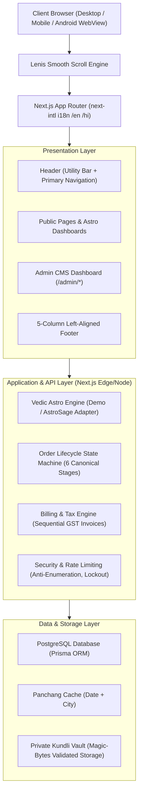
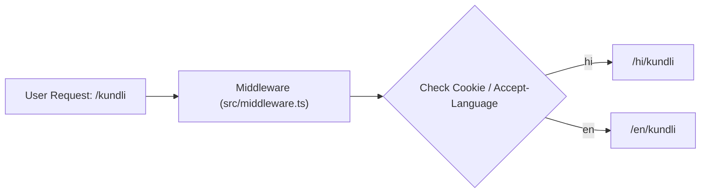
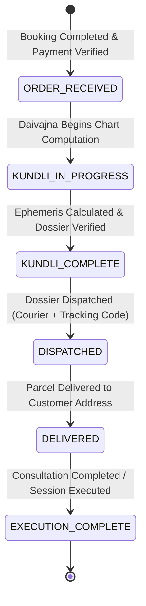
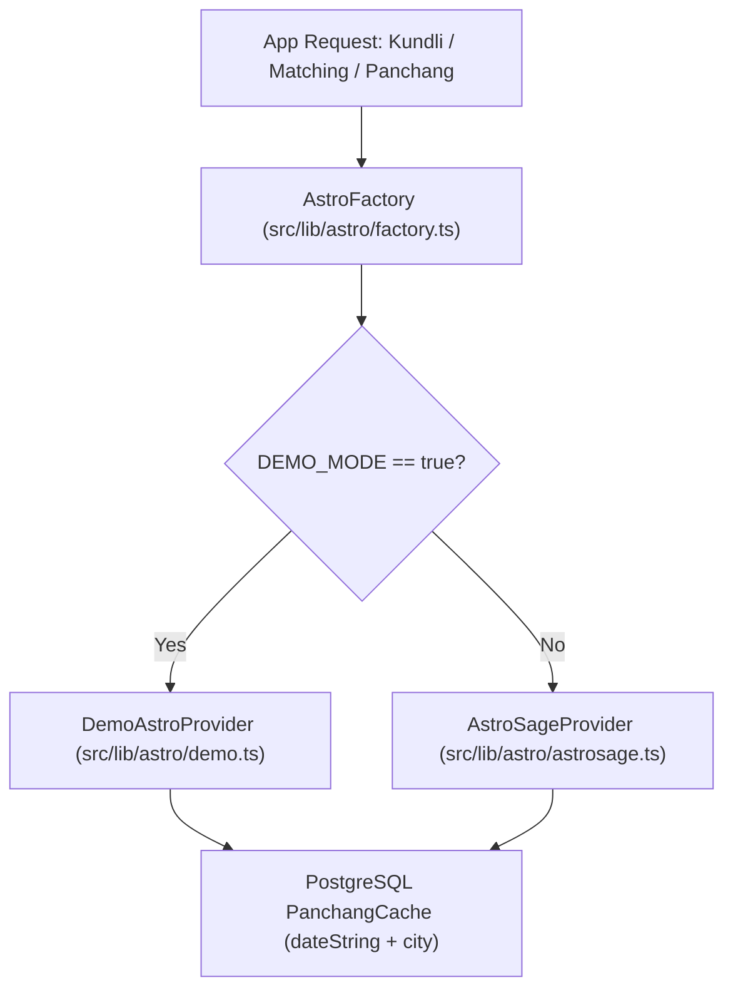

# System Architecture & Technical Specifications

> **Maharshi Kanad Jyotish Kendra (महर्षि कणाद ज्योतिष केंद्र)**  
> Canonical Vedic Ephemeris & Astronomical Jyotish Siddhanta Web Platform

---

## 1. High-Level Architecture Overview

The platform is designed as a modern, high-performance web application built on **Next.js 14 App Router**, **TypeScript**, **Tailwind CSS**, and **PostgreSQL with Prisma ORM**. It serves bilingual Vedic consultation booking, mathematical chart calculations, an asynchronous order lifecycle state machine, private customer vault storage, and an administrative CMS.



---

## 2. Core Frontend Design Philosophy

### 2.1 Vedic Broadsheet Typography & Left-Aligned Layout
- **No Center Alignment Constraint**: By design, container elements do NOT use restrictive centered boundaries (e.g. `max-w-7xl mx-auto`). Instead, pages utilize the entire browser viewport (`w-full px-4 sm:px-6 lg:px-8 xl:px-12`) with authoritative left-alignment.
- **Vedic Color Palette**:
  - Primary: Deep Saffron / Vermillion (`#b84200`, `#ff793f`)
  - Secondary: Dashashwamedh Ochre & Temple Crimson (`#6d2200`, `#8c2c00`)
  - Surface: Parchment cream and warm slate broadsheet tones (`#fff8f5`, `#fdf1eb`)
  - Outline: Muted copper border treatments (`border-outline-variant`)
- **Strict Touch Target Compliance**: All interactive buttons, form selects, carousel controllers, and menu links strictly meet or exceed the **44px minimum touch target height** for Android WebView and iOS Safari standards.

### 2.2 Lenis Smooth Scrolling Engine
The application integrates **Lenis** (`lenis/react`) via a dedicated client provider at `src/components/providers/SmoothScrollProvider.tsx`:
```tsx
<ReactLenis
  root
  options={{
    lerp: 0.1,
    duration: 1.2,
    smoothWheel: true,
    wheelMultiplier: 1.0,
    touchMultiplier: 1.8,
    infinite: false,
  }}
>
  {children}
</ReactLenis>
```
- **SSR Safety**: Wrapped in Next.js App Router root layout `src/app/[locale]/layout.tsx` without disrupting server-side rendering or streaming.
- **Scroll Container Protection**: Body styles use `overflow-x: clip` to eliminate accidental horizontal scroll bars on mobile viewports without trapping root window scrolling.

---

## 3. Bilingual Routing Architecture (`next-intl`)

Internationalization is implemented through `next-intl` with language routing under `/[locale]`:
- **Supported Locales**: `hi` (Hindi - हिन्दी) and `en` (English).
- **Zero Hardcoded Strings**: All UI copy, errors, and system strings are maintained in `messages/hi.json` and `messages/en.json`.
- **Navigation Middleware**: `src/middleware.ts` routes visitors to their preferred or persisted language and preserves path slugs during language switches.



---

## 4. Order Lifecycle State Machine

Orders progress through six canonical, auditable stages. Every transition creates an immutable record in the `OrderStatusEvent` table:



### State Definitions:
1. `ORDER_RECEIVED`: Order created and payment verified (Instant Razorpay or Admin-verified manual UPI/bank).
2. `KUNDLI_IN_PROGRESS`: Daivajna assigns chart calculation to Kendra mathematical team.
3. `KUNDLI_COMPLETE`: Janampatri calculations completed, verified down to arc-seconds, and PDF dossier uploaded to the Customer Vault.
4. `DISPATCHED`: Physical woodblock dossier or commemorative certificate shipped; courier name and consignment number recorded.
5. `DELIVERED`: Courier delivery confirmed.
6. `EXECUTION_COMPLETE`: Telephonic or in-person consultation fulfilled.

---

## 5. Astrological Engine & Provider Pattern

The calculation engine abstracts data providers through the `AstroProvider` interface (`src/lib/astro/types.ts`):



- **Demo Engine**: Returns Surya Siddhanta sample charts with explicit `isDemo: true` flag and "Sample output, not a real calculation" notice in both Hindi and English.
- **Production Engine**: Ready for Swiss Ephemeris or AstroSage API credentials.
- **Database Caching**: Daily planetary transits (Graha Spashta) and 5-limb Panchang items are cached in `PanchangCache` by `dateString + city`, eliminating duplicate third-party calls.

---

## 6. Security Architecture & Rate Limiting

### 6.1 Customer Authentication Policy
- **Mobile OTP Only**: Customer accounts authenticate exclusively via 6-digit Mobile OTP. Password login is strictly reserved for administrative personnel.
- **Anti-Brute Force**: 
  - OTP generation is limited to 3 requests per 60 seconds per phone number, and 10 requests per 60 seconds per IP address.
  - OTP verification fails after 5 consecutive incorrect attempts.
- **Admin Password Lockout**: Admin accounts are locked for 15 minutes after 5 consecutive failed login attempts per email address.

### 6.2 Public Order Tracking Privacy
- The public tracker (`/track`) requires **both** the Order Number (e.g. `MKJK-2026-0001`) and the customer's verified Phone Number.
- Rate-limited to 15 queries per 60 seconds per IP and 5 queries per 60 seconds per Order Number to prevent automated enumeration.

### 6.3 Private Kundli Vault Storage
- Customer documents are stored with unique, non-guessable storage keys.
- **Magic-Bytes Verification**: Uploaded files must match authentic `%PDF-` file signatures (or valid image magic bytes).
- **Upload Ceiling**: File sizes are strictly enforced at a 10MB maximum ceiling.
- **Access Authorization**: Vault files can only be accessed by the authenticated customer who owns the order or by an active administrator.
