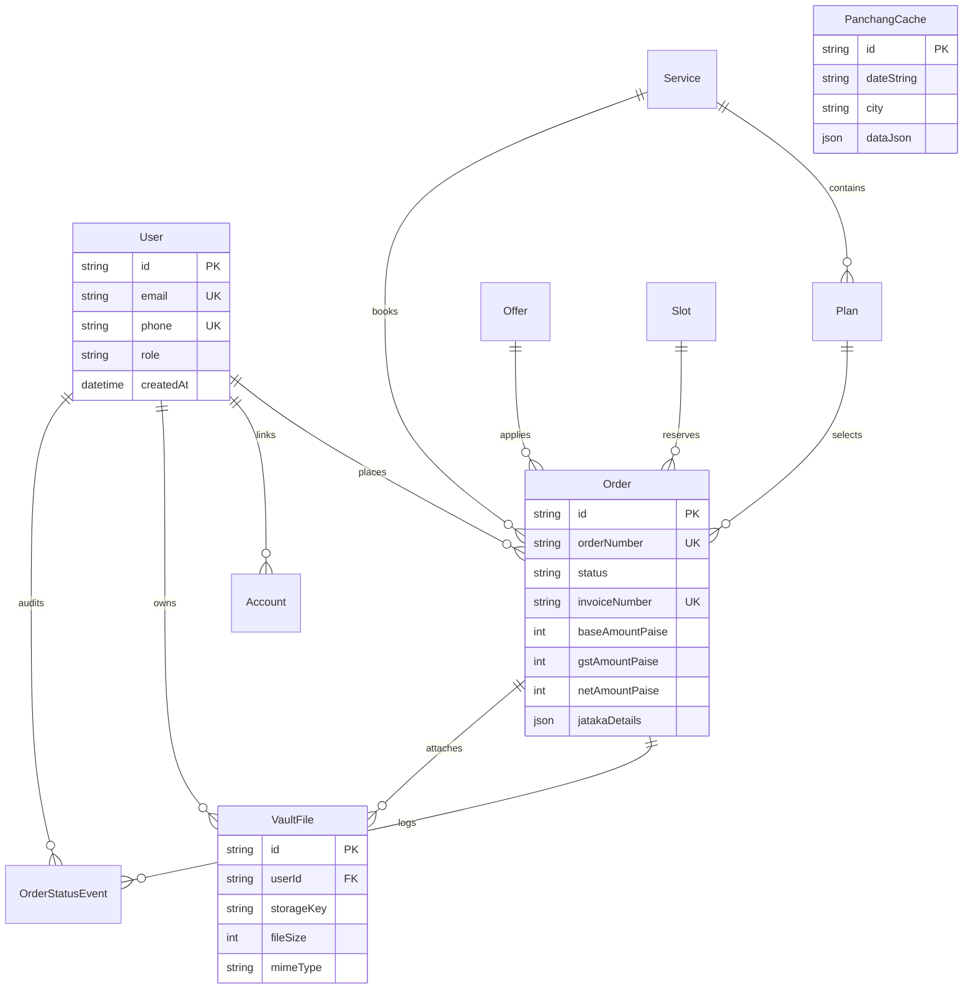

# Database Schema & Entity Relationship Model

> **Maharshi Kanad Jyotish Kendra (महर्षि कणाद ज्योतिष केंद्र)**  
> PostgreSQL Schema Reference via Prisma ORM

---

## 1. Entity-Relationship Overview

The database uses PostgreSQL with strict relational integrity, cascade deletions on dependent records, and indexed queries for high-throughput public traffic:

---

## 2. Core Enumerations

### 2.1 User Roles (`Role`)
- `USER`: Customer account capable of booking consultations, tracking orders, and viewing private vault charts.
- `ADMIN`: Administrator with full CMS access, coupon management, order status auditing, and financial controls.

### 2.2 Order Lifecycle Status (`OrderStatus`)
- `ORDER_RECEIVED`: Booking placed and payment confirmed.
- `KUNDLI_IN_PROGRESS`: Daivajna computation underway.
- `KUNDLI_COMPLETE`: Mathematical calculations verified; chart dossier ready.
- `DISPATCHED`: Physical dossier dispatched with courier tracking.
- `DELIVERED`: Dossier delivered to client location.
- `EXECUTION_COMPLETE`: Telephonic or in-person consultation completed.

### 2.3 Payment Modes & Statuses
- **Modes (`PaymentMode`)**:
  - `RAZORPAY`: Instant gateway (Cards, Netbanking, UPI).
  - `MANUAL_UPI`: Direct Temple VPA transfer.
  - `MANUAL_BANK`: Bank NEFT/RTGS transfer.
  - `MANUAL_QR`: Scanned UPI QR transfer.
- **Statuses (`PaymentStatus`)**:
  - `PENDING`: Awaiting customer action.
  - `AWAITING_VERIFICATION`: Manual payment submitted; awaiting admin audit.
  - `PAID`: Payment verified and confirmed.
  - `FAILED`: Payment failure or gateway rejection.
  - `REFUNDED`: Payment refunded by Kendra administration.

---

## 3. Data Models Dictionary

### 3.1 `User`
Customer and administrative user records.
- `id` (`String`, PK): Unique cuid.
- `name` (`String?`): Full name.
- `email` (`String?`, Unique): Email address (Used for admin login).
- `phone` (`String?`, Unique): Mobile phone number with country prefix (Required for customer OTP login).
- `passwordHash` (`String?`): Bcrypt salted hash (Restricted to Admin accounts).
- `role` (`Role`, Default `USER`): Account permissions level.
- `createdAt` / `updatedAt` (`DateTime`): Timestamps.

### 3.2 `Order`
Central commerce record capturing the astrological consultation and audit history.
- `id` (`String`, PK): Unique cuid.
- `orderNumber` (`String`, Unique): Sequential public order identifier (e.g. `MKJK-2026-0001`).
- `userId` (`String?`, FK): Linked customer user.
- `serviceId` (`String?`, FK): Associated Vedic service.
- `planId` (`String?`, FK): Selected tier plan.
- `offerId` (`String?`, FK): Applied discount offer.
- `offerCode` (`String?`): Immutable snapshot of coupon code at booking time.
- `slotId` (`String?`, FK): Reserved calendar consultation slot.
- `status` (`OrderStatus`, Default `ORDER_RECEIVED`): Current lifecycle stage.
- `jatakaDetails` (`Json`): Comprehensive birth data payload:
  - `name`: Full birth name
  - `gender`: `male` / `female`
  - `dob`: Date of birth (`YYYY-MM-DD`)
  - `tob`: Time of birth (`HH:mm`)
  - `pob`: Place of birth (City, State)
  - `latitude` / `longitude`: Exact geographic coordinates
  - `gotra`: Family lineage Gotra
  - `queries`: Array of specific questions for Daivajna
- `baseAmountPaise` (`Int`): Original plan price in Paise.
- `discountAmountPaise` (`Int`, Default 0): Discount in Paise.
- `taxableAmountPaise` (`Int`): Pre-tax net amount in Paise.
- `gstRateBasisPoints` (`Int`, Default 1800): 18.00% GST in basis points.
- `gstAmountPaise` (`Int`): Computed GST in Paise.
- `netAmountPaise` (`Int`): Total customer payable amount in Paise.
- `invoiceNumber` (`String?`, Unique): Sequential tax invoice identifier (e.g. `INV-2026-0001`).
- `paymentMode` (`PaymentMode`, Default `RAZORPAY`): Selected payment method.
- `paymentStatus` (`PaymentStatus`, Default `PENDING`): Current payment state.
- `courierName` (`String?`): Name of dispatch courier (e.g. DTDC, BlueDart, India Post).
- `trackingNumber` (`String?`): Consignment tracking code.
- `adminNotes` (`String?`): Internal Kendra audit commentary.

### 3.3 `OrderStatusEvent`
Immutable chronological audit log for order transitions.
- `id` (`String`, PK): Unique cuid.
- `orderId` (`String`, FK): Target order.
- `status` (`OrderStatus`): New lifecycle stage.
- `note` (`String?`): Audit note explaining status change.
- `changedById` (`String?`, FK): Administrator who executed the transition.
- `createdAt` (`DateTime`): Timestamp of transition.

### 3.4 `VaultFile`
Customer private document storage tracking uploaded Kundli charts.
- `id` (`String`, PK): Unique cuid.
- `orderId` (`String?`, FK): Associated consultation order.
- `userId` (`String`, FK): Customer account authorized to download.
- `titleEn` / `titleHi` (`String`): Bilingual document titles.
- `fileName` (`String`): Original uploaded filename.
- `storageKey` (`String`): Internal private storage path.
- `fileSize` (`Int`): File size in bytes (Max 10 MB).
- `mimeType` (`String`, Default `application/pdf`): Validated MIME type.

### 3.5 `PanchangCache`
Database cache for computed Surya Siddhanta daily ephemeris.
- `id` (`String`, PK): Unique cuid.
- `dateString` (`String`): Date formatted as `YYYY-MM-DD`.
- `city` (`String`): Normalized city name (e.g. `varanasi`).
- `dataJson` (`Json`): Serialized 5-limb Panchang and Graha Spashta coordinates.
- Unique Index: `@@unique([dateString, city])`.

### 3.6 `RateLimit`
Sliding window rate-limiting store.
- `id` (`String`, PK): Unique cuid.
- `scope` (`String`): Scope identifier (`OTP_PHONE`, `OTP_IP`, `ADMIN_LOGIN_EMAIL`, `ADMIN_LOGIN_IP`, `TRACKER_IP`).
- `identifier` (`String`): Phone, IP, or Email.
- `count` (`Int`, Default 1): Hit count within current window.
- `windowEnd` (`DateTime`): Expiry timestamp of the active window.

### 3.7 `AdminSettings`
Kendra sanctuary configuration and contact numbers.
- `id` (`String`, PK): Single-record identifier (`default`).
- `siteNameEn` / `siteNameHi` (`String?`): Sanctum titles.
- `phone1` (`String?`): Primary helpline (`+91-9827991224`).
- `phone2` (`String?`): Secondary helpline (`+91-7509124672`).
- `email` (`String?`): Official contact email (`contact@kanadastro.org`).
- `addressEn` / `addressHi` (`String?`): Sanctum campus address.
- `city` (`String?`): Primary city (`Varanasi`).
- `latitude` / `longitude` (`Float?`): Geocoordinates (`25.3176° N`, `82.9739° E`).
- `upiVpa` (`String?`): Direct Temple UPI VPA.
- `bankAccountName`, `bankAccountNumber`, `bankIfsc`, `bankName` (`String?`): Bank NEFT/RTGS details.
- `qrCodeUrl` (`String?`): Scannable UPI QR code image URL.
- `gstin` (`String?`): Kendra GST Identification Number.
- `socialFacebook`, `socialTwitter`, `socialInstagram`, `socialYoutube` (`String?`): Official social media URLs.
